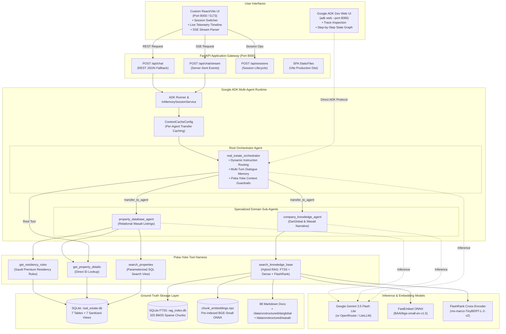

# DarGlobal & Wasalt Real Estate AI Advisor

[](https://www.python.org/)
[](https://github.com/google/adk)
[](https://fastapi.tiangolo.com/)
[](https://react.dev/)
[](https://vitejs.dev/)
[](https://tailwindcss.com/)
[](https://www.sqlite.org/fts5.html)
[](https://github.com/qdrant/fastembed)
[](https://www.docker.com/)

A production-grade, multi-agent real estate intelligence system designed to consult prospective buyers, international investors, and brokers across two premier property domains: international luxury branded residences from **DarGlobal** and domestic residential, commercial, and judicial auction listings across Saudi Arabia from **Wasalt**. Built with Google Agent Development Kit (ADK 2.0), FastAPI, hybrid RAG (SQLite FTS5 BM25 + ONNX Dense Embeddings + FlashRank Cross-Encoder Reranking), and a high-performance React/Vite interface featuring live execution telemetry and sub-agent handoff visualization.

---

## Demo

<!--
  DEMO VIDEO INTEGRATION GUIDE:
  Option A (Recommended for GitHub): Drag-and-drop 'data/video/demo.mp4' directly into the GitHub web editor 
           when editing this README on GitHub. GitHub will upload it to its asset CDN and generate an inline 
           video player tag: https://github.com/user-attachments/assets/<asset-id>

(https://github.com/user-attachments/assets/e15bd6e8-aad5-46f0-a1ca-b92844a14621)


  Option B (Local/Repo-hosted): Place your recorded screencast as an animated GIF at 'data/video/demo.gif' 
           or link directly to 'data/video/demo.mp4'.
-->

| Real-Time Execution Timeline & Multi-Agent Handoffs |
| :-------------------------------------------------: |
| ) |
| *Recorded interaction displaying live ADK thinking tokens, sub-agent handoffs, and hybrid RAG tool execution.* |
| *Direct Video File:* [Download / View data/video/demo.mp4](./data/video/demo.mp4) |

---

## Domain Scope: DarGlobal & Wasalt

This AI advisor provides precise, verified answers by querying dedicated structured relational databases and an 88-document indexed knowledge corpus extracted directly from public websites. It operates strictly on ground-truth data to prevent real estate hallucinations:

### 1. DarGlobal (`darglobal.co.uk`)
* **Portfolio Scope:** Ultra-luxury international branded residences and high-profile architectural towers.
* **Key Developments:** Trump Tower Jeddah (Corniche), Pagani Residences (DaVinci Tower, Dubai), Aston Martin Residences, Elie Saab Luxury Villas, W Residences, and Dolce & Gabbana collaborations across Saudi Arabia, UAE, Qatar, Spain, and the United Kingdom.
* **Information Grounded:** Architectural specifications, completion dates, unit typologies (penthouses, 1–4 bedroom residences), square meterage, exclusive lifestyle privileges (Trump Private Club, cigar lounges, spa facilities), and foreign freehold ownership eligibility.

### 2. Wasalt (`wasalt.sa`)
* **Portfolio Scope:** Comprehensive domestic real estate marketplace across the Kingdom of Saudi Arabia.
* **Key Listings:** Verified residential villas, apartments, residential/commercial land parcels, duplexes, compound housing, and regulated judicial auctions (*Mawad* auctions).
* **Coverage Areas:** Major Saudi municipalities including Riyadh, Jeddah, Dammam, Al-Khobar, Mecca, and Medina.
* **Information Grounded:** Listing prices in SAR, price per square meter, bedroom/bathroom configurations, zoning rules, property IDs, and official guidelines for international buyers and Saudi Premium Residency qualification.

---

## System Architecture

The solution uses a hierarchical multi-agent pattern orchestrated through Google ADK 2.0, backed by read-only SQL views, local ONNX neural search, and a custom Server-Sent Events (SSE) streaming engine.



### Multi-Agent Design & Routing Logic
1. **`real_estate_orchestrator` (Root Agent):** Front-facing consultative advisor. Evaluates incoming queries, greets users, tracks conversational state (`last_active_agent`, `selected_property_id`, `last_search_city`), and delegates domain-specific work without polluting the main prompt context.
2. **`company_knowledge_agent` (Sub-Agent):** Dedicated to DarGlobal branded projects, luxury specs, amenities, architectural narratives, and Wasalt institutional guides. Calls `search_knowledge_base` using a 3-stage hybrid search pipeline.
3. **`property_database_agent` (Sub-Agent):** Dedicated to real-time property searches, budget filtering, city filtering, land parcel queries, judicial auctions, and foreign ownership compliance. Calls `search_properties` against sanitized SQLite views.
4. **Context Cache Configuration (`ContextCacheConfig`):** Prevents expensive prompt cache invalidation during inter-agent transfers, assigning each agent an isolated cache partition.

---

## Production Engineering Highlights

* **Sub-Second Hybrid RAG Engine:** Combines SQLite FTS5 BM25 sparse matching with Dense Vector retrieval via FastEmbed ONNX (`bge-small-en-v1.5`) and FlashRank Cross-Encoder reranking (`ms-marco-TinyBERT-L-2-v2`). Caches pre-computed numpy embeddings (`chunk_embeddings.npz`) to achieve retrieval latencies under 50ms over 88 documents.
* **Poka-Yoke Read-Only Relational Layer:** Restricts database access exclusively to sanitized, indexed SQL views (`v_properties_search`, `v_projects_search`, `v_auctions_search`). SQL injection and unintended mutations are architecturally impossible.
* **Server-Sent Events (SSE) Streaming Pipeline:** Custom FastAPI SSE generator emitting structured, granular events: `session`, `agent_start`, `agent_change`, `tool_call`, `tool_result`, `thinking`, `text_delta`, `final_response`, and `done`.
* **Live Execution Telemetry Timeline (`AgentActivityCard`):** A custom SalesOS React component providing instant UI feedback: active agent badges, transfer arrows (`HANDOFF: orchestrator → subagent`), live elapsed timers, thinking accordions, and expandable tool input/output JSON viewers.
* **Process & Socket Collision Guard:** Automated socket pre-flight checks on Windows (`is_port_in_use`) preventing half-open TCP deadlocks, paired with 30-second client-side connection timeout guards.
* **Ephemeral Telemetry & Startup Log Rotation:** Automated FastAPI `lifespan` hook that resets trace logs (`agent_activity.log`) on boot and enforces a 2MB file size ceiling to prevent unbounded disk usage in cloud environments.
* **Two-Pass Stealth Scraping Suite:** Decouples bot-evasion crawling (Patchright with stealth Chromium + `curl_cffi` TLS/JA3 impersonation into zlib-compressed SQLite raw cache) from multi-core offline CPU parsing.
* **Multi-Stage Cloud Docker Container:** Debian-based multi-stage Docker build (`node:20-slim` + `python:3.11-slim`) resolving musl libc stack recursion limits and pre-caching neural models for instant container cold starts on Render, Cloud Run, or Railway.

---

## Prerequisites & Environment Setup

### Prerequisites
* **Python:** `3.10`, `3.11`, or `3.12`
* **Node.js:** `v18.x` or `v20.x` (with npm `9.x`+)
* **Docker & Docker Compose:** Optional, required for containerized deployment.

### Environment Variables
Configure your environment variables in `.env` at the project root or in `backend/agents/real_estate_advisor/.env`:

| Variable Name | Description | Required | Default / Format |
| :--- | :--- | :---: | :--- |
| `GEMINI_API_KEY` | Google Gemini API key for Google ADK runtime | **Yes\*** | `AIzaSy...` |
| `ADK_MODEL_NAME` | Primary model identifier passed to Google ADK | No | `gemini-3.5-flash-lite` |
| `OPENROUTER_API_KEY` | Alternative LLM API key for LiteLLM routing | Optional | `sk-or-v1-...` |
| `DEFAULT_LLM_MODEL` | Target model identifier on OpenRouter | Optional | `meta-llama/llama-3.3-70b-instruct:free` |
| `APP_ENV` | Application environment mode | No | `development` (`production`, `staging`) |
| `PORT` | Listening port for FastAPI ASGI server | No | `8000` (Injected dynamically on Render) |
| `HOST` | Binding network interface | No | `0.0.0.0` |
| `DEBUG` | Enable debug logs and hot-reloader | No | `True` |

*\*Note: Provide either `GEMINI_API_KEY` or `OPENROUTER_API_KEY` to enable live LLM generation.*

---

## How to Run the Chatbot (Two Methods)

### Method 1: Custom Web UI (Production / Full-Stack Experience)

The production web interface serves the compiled React Single Page Application (SPA) directly from FastAPI on port `8000`.

#### Option A: Local Python & Node Execution

```bash
# 1. Clone repository & install Python dependencies
git clone https://github.com/your-username/DarGlobal_website_chatbot.git
cd DarGlobal_website_chatbot
pip install -r backend/requirements.txt

# 2. Build the React frontend
cd frontend
npm install
npm run build
cd ..

# 3. Synchronize static bundle to backend static directory
# Windows PowerShell:
Copy-Item -Path "frontend/dist/*" -Destination "backend/src/static" -Recurse -Force
# Linux / macOS:
# cp -r frontend/dist/* backend/src/static/

# 4. Start the FastAPI Application
python main.py
```
Open **`http://localhost:8000`** in your browser.

#### Option B: Frontend Hot-Reload Development Mode (HMR)
When modifying React components, run the frontend with Vite's dev server:
```bash
# Terminal 1: Backend API
python main.py

# Terminal 2: Vite Dev Server (Proxies /api calls to port 8000)
cd frontend
npm run dev
```
Open **`http://localhost:5173`** in your browser.

#### Option C: Production Docker Deployment
```bash
# Build multi-stage cloud container
docker build -f Dockerfile.production -t darglobal-chatbot .

# Run container binding to port 8000
docker run -d -p 8000:8000 --env-file backend/agents/real_estate_advisor/.env --name darglobal_app darglobal-chatbot
```

#### Option D: Docker Compose (Dev Environment)
```bash
docker compose up --build
```
* Backend available at: `http://localhost:8000`
* Frontend dev server at: `http://localhost:5173`

---

### Method 2: Google ADK Native Dev UI (`adk web`)

Google ADK provides an interactive developer inspection environment to evaluate agent routing, step through multi-agent handoffs, inspect raw JSON function calls, and verify prompt behaviors in isolation.

```bash
# Run adk web pointing to the real_estate_advisor agent package
adk web backend/agents/real_estate_advisor --port 8080
```
Open **`http://localhost:8080`** in your browser.

> [!TIP]
> **When to use `adk web`:** Use this interface to evaluate agent decision boundaries, inspect context token counts, benchmark handoffs between `real_estate_orchestrator` and `company_knowledge_agent`, or debug newly added tools without running the full web stack.

---

## Data Pipeline / Ingestion

The repository includes a web scraping, parsing, and indexing pipeline designed to refresh public data from DarGlobal and Wasalt without manual intervention:

```bash
# 1. Run DarGlobal scrapers (Harvests homepage and luxury collection markdown)
python backend/src/scraper/darglobal_home_scraper.py
python backend/src/scraper/darglobal_collection_scraper.py

# 2. Run Wasalt stealth crawler (Stores zlib-compressed HTML into SQLite raw cache)
python backend/src/scraper/wasalt_raw_fetcher.py --limit 100

# 3. Run multi-process offline parser (Extracts properties, projects, auctions into DB & CSVs)
python backend/src/scraper/wasalt_offline_parser.py

# 4. Rebuild Hybrid RAG Index (Builds FTS5 database and exports dense embeddings)
python backend/src/rag/build_index.py
python backend/src/rag/export_embeddings.py

# 5. Run Golden Evaluation Harness (25-Query Regression & Accuracy Suite)
python backend/eval/run_eval.py

# 6. Run Integration & Unit Test Suite
pytest backend/tests -v
```

---

## Project Structure

```text
DarGlobal_website_chatbot/
├── backend/                                # Backend application & agent runtime
│   ├── agents/
│   │   └── real_estate_advisor/            # Primary Google ADK Agent Package
│   │       ├── agent.py                    # Root orchestrator & ADK App definition
│   │       ├── prompt.py                   # Dynamic, global & static system instructions
│   │       ├── callbacks.py                # Telemetry tracing & startup log rotation
│   │       ├── .env                        # Local agent secrets & model configuration
│   │       └── subagents/
│   │           ├── company_knowledge_agent/# DarGlobal & Wasalt RAG sub-agent
│   │           │   ├── agent.py
│   │           │   ├── prompt.py
│   │           │   └── tools.py            # search_knowledge_base hybrid RAG tool
│   │           └── property_database_agent/# Wasalt SQL search sub-agent
│   │               ├── agent.py
│   │               ├── prompt.py
│   │               └── tools.py            # search_properties, residency rules tools
│   ├── src/
│   │   ├── config/                         # Pydantic Settings & environment schemas
│   │   ├── models/                         # Request, response, and database schemas
│   │   ├── routes/                         # FastAPI routers (/api/chat, /api/health)
│   │   ├── services/                       # Embedded ADK Runner & session orchestration
│   │   ├── scraper/                        # Two-pass stealth scraping & parsing suite
│   │   ├── rag/                            # FTS5 indexing, vector export & view sanitizer
│   │   ├── static/                         # Production SPA bundle (compiled Vite dist)
│   │   ├── utils/                          # Structured logging & validation routines
│   │   └── main.py                         # FastAPI factory, SPA mounting & lifespan hooks
│   ├── eval/                               # Golden evaluation suite (run_eval.py, eval_report.json)
│   ├── tests/                              # Pytest suite (23 unit & integration tests)
│   └── requirements.txt                    # Production Python package requirements
├── data/
│   ├── structured/                         # Normalized SQLite database (real_estate.db)
│   ├── unstructured/                       # 88 Normalized Markdown knowledge docs
│   ├── index/                              # FTS5 search index (rag_index.db) & embeddings (.npz)
│   ├── darglobal/                          # Scraped DarGlobal collection dumps & link graph
│   ├── wasalt/                             # Wasalt raw caches, CSVs, and offline checkpoints
│   └── video/                              # Demo screencast (demo.mp4 / demo.gif)
├── frontend/                               # React 18 + Vite + Tailwind CSS Application
│   ├── src/
│   │   ├── components/                     # Header, ChatWindow, MessageBubble, AgentActivityCard
│   │   ├── hooks/                          # useChat.js (SSE parser & session management)
│   │   ├── pages/                          # ChatPage.jsx (Responsive split-panel UI)
│   │   └── services/                       # api.js (Fetch client with 30s timeout guard)
│   ├── package.json                        # Frontend dependencies & build scripts
│   └── vite.config.js                      # Vite config with React deduplication & proxy
├── Dockerfile.production                   # Multi-stage container (node:20-slim + python:3.11-slim)
├── Dockerfile.backend                      # Development container for FastAPI
├── Dockerfile.frontend                     # Development container for Vite dev server
├── docker-compose.yml                      # Full-stack local development orchestration
├── main.py                                 # Root application launcher with port collision check
├── pyproject.toml                          # Project configuration & test paths
└── README.md                               # Project documentation & reference manual
```

---

## Example Prompts to Try

Reviewers and engineers can test the multi-agent system across different operational modes:

### 1. DarGlobal Luxury Branded Residence Inquiry
> *"Tell me about Trump Tower Jeddah. What are its location, unit configurations, completion date, and exclusive amenities?"*
* **Expected Flow:** `real_estate_orchestrator` transfers control to `company_knowledge_agent` $\rightarrow$ calls `search_knowledge_base` $\rightarrow$ streams comprehensive project narrative, unit mix (1–4 BR & penthouses), December 2029 completion date, and Trump Private Club privileges with verified source links.

### 2. Wasalt Filtered Property Search
> *"I am looking for a 3-bedroom villa for sale in Riyadh with a budget under 3,500,000 SAR. What properties are available?"*
* **Expected Flow:** `real_estate_orchestrator` transfers control to `property_database_agent` $\rightarrow$ executes `search_properties` against `v_properties_search` $\rightarrow$ streams matching listings with prices, locations, square meters, and property IDs.

### 3. Judicial Auction Inquiry (Mawad Auctions)
> *"Are there any active judicial or public auctions listed in Jeddah or Mecca? What are the starting bid amounts?"*
* **Expected Flow:** Control delegates to `property_database_agent` $\rightarrow$ queries auction records $\rightarrow$ summarizes starting bids, lot counts, and court auction compliance rules.

### 4. Foreign Ownership & Saudi Premium Residency
> *"Can an international buyer purchase freehold property in Saudi Arabia, and does purchasing a residence in DarGlobal developments qualify for Saudi Premium Residency?"*
* **Expected Flow:** Sub-agent executes `get_residency_rules` $\rightarrow$ cites 100% foreign freehold ownership provisions and the 4,000,000 SAR real estate investment threshold for the Saudi Premium Residency program.

### 5. Multi-Turn Contextual Follow-Up
> *Turn 1:* *"Tell me about the Pagani residences in Dubai."*  
> *Turn 2:* *"What are the key interior design features and who is the architect?"*
* **Expected Flow:** In Turn 2, the orchestrator preserves the session context and answers directly using the prior context without asking the user to repeat the property name.

### 6. Out-of-Scope Guardrail Test
> *"Can you write Python code to calculate mortgage interest amortization?"*
* **Expected Flow:** Root orchestrator politely declines, stating its strict mandate as an advisory assistant specialized exclusively in DarGlobal developments and Wasalt listings.

---

## Disclaimer

This software project is an independent engineering demonstration and portfolio application developed solely for evaluation and educational purposes. It utilizes **publicly accessible website information** retrieved from [DarGlobal](https://darglobal.co.uk) and [Wasalt](https://wasalt.sa). This project is **not** officially affiliated with, authorized by, maintained by, or endorsed by DarGlobal Holdings or Wasalt Real Estate Company. All registered trademarks, product names, logos, and brands cited are the property of their respective owners.
