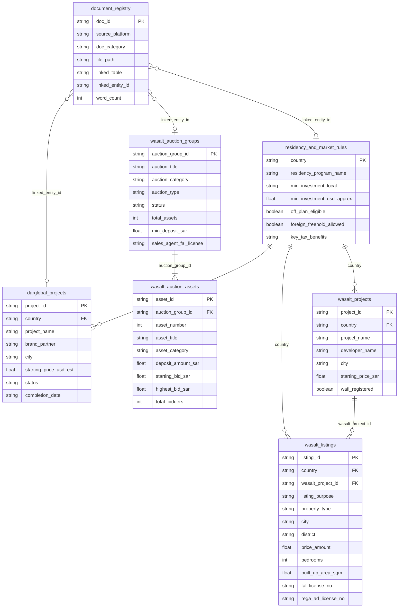

# DarGlobal & Wasalt Real Estate Dataset Architecture & RAG Specification

> **Document Version:** 1.0.0  
> **Dataset Location:** `data/`  
> **Structured Database:** `data/structured/db/real_estate.db` (SQLite 3)  
> **Raw Streaming Sinks:** `data/structured/raw_jsonl/*.jsonl`  
> **Unstructured Knowledge Base:** `data/unstructured/` (Markdown with YAML Frontmatter)  
> **Language Purity:** 100% English across all relational columns (0 Arabic violations)  
> **Relational Integrity:** `PRAGMA foreign_keys = ON;` (0 violations)  

---

## 1. Executive Data Architecture Overview

The DarGlobal and Wasalt data ingestion pipeline captures a hybrid real estate repository combining **high-precision relational structured data** and **rich semantic unstructured text**. This architecture serves an Agentic AI Chatbot capable of handling both deterministic relational queries (e.g., price ranges, room counts, auction bid deposits, FAL licenses, golden visa thresholds) and complex semantic reasoning (e.g., brand design philosophies, architectural narratives, legal compliance procedures, market forecasts).

### Three-Tier Physical Storage Layout

```text
data/
├── structured/
│   ├── raw_jsonl/                     # Tier 1: Append-only streaming sinks (O(B) memory writes)
│   │   ├── residency_and_market_rules.jsonl
│   │   ├── darglobal_projects.jsonl
│   │   ├── wasalt_projects.jsonl
│   │   ├── wasalt_listings.jsonl
│   │   ├── wasalt_auction_groups.jsonl
│   │   └── wasalt_auction_assets.jsonl
│   ├── db/
│   │   └── real_estate.db             # Tier 2: Relational SQLite store (indexed, foreign keys enabled)
│   └── manifests/
│       └── document_registry.jsonl    # Tier 2.5: Bridge table linking Markdown docs to entities
│
├── unstructured/                      # Tier 3: Markdown knowledge base (YAML frontmatter + rich body)
│   ├── darglobal/
│   │   ├── dg_01_*.md to dg_08_*.md   # 8 Core corporate, residency, FAQ, and legal guides
│   │   ├── projects/<slug>.md         # 33 Luxury branded residence project narratives & FAQs
│   │   ├── insights/<slug>.md         # 25 Market intelligence Q&A articles
│   │   └── press/<slug>.md            # 15 Dated corporate press releases and earnings reports
│   └── wasalt/
│       ├── ws_01_*.md to ws_07_*.md   # 7 Platform, broker CRM, auction, and legal guides
│       └── blog_guides/<slug>.md      # 2026 Riyadh market forecasts & neighborhood guides
│
└── checkpoints/
    ├── scraper_state.json             # Resumable cursors, completed partition states, seen IDs
    ├── failed_urls.jsonl              # Dead-letter queue for retryable network anomalies
    └── completeness_report.json       # Automated post-scrape integrity audit (FK, nulls, language)
```

---

## 2. Entity-Relationship Diagram (ERD)



---

## 3. Structured Data: Relational Table Specifications

### 3.1 Table: `residency_and_market_rules`
- **Total Rows:** `9`
- **Total Columns:** `10`
- **Primary Key:** `country`
- **Raw File Sink:** `data/structured/raw_jsonl/residency_and_market_rules.jsonl` (or manifests for `document_registry`)

#### Column Dictionary & Distinct Value Profile

| Column Name | Data Type | Constraint | Description | Distinct Count | Sample Unique Values (Top 10) |
| :--- | :---: | :---: | :--- | :---: | :--- |
| `country` | `TEXT` | `PK NULL` | Primary key: ISO/standardized country name (e.g. 'Saudi Arabia', 'UAE', 'Oman'). | 9 | `Greece`, `Maldives`, `Oman`, `Qatar`, `Saudi Arabia`, `Spain`, `UAE`, `UK`, `USA` |
| `residency_program_name` | `TEXT` | `NULL` | Official statutory residency/visa program name (e.g. 'UAE 10-Year Golden Visa'). | 9 | `Premium Residency (Rea...`, `UAE 10-Year Golden Vis...`, `Investor Residency Pro...`, `Real Estate Permanent ...`, `Spain Golden Visa / Re...`, `UK Innovator / Global ...`, `Corporate Residency & ...`, `Greece Golden Visa Pro...`, `EB-5 Immigrant Investo...` |
| `min_investment_local` | `TEXT` | `NULL` | Minimum qualifying investment threshold in local statutory currency (e.g. '2,000,000 AED'). | 9 | `4,000,000 SAR`, `2,000,000 AED`, `250,000 OMR`, `3,650,000 QAR (Permane...`, `500,000 EUR`, `Freehold Market Discre...`, `1,000,000 USD`, `800,000 EUR (Tier 1) /...`, `800,000 USD (TEA) / 1,...` |
| `min_investment_usd_approx` | `REAL` | `NULL` | Normalized approximate investment threshold in USD for global cross-filtering. | 8 | `1066667.0`, `544500.0`, `650000.0`, `1000000.0`, `545000.0`, `2500000.0`, `870000.0`, `800000.0` |
| `off_plan_eligible` | `INTEGER` | `NULL` | Boolean (1/0): Whether purchasing off-plan/under-construction property qualifies for residency. | 1 | `1` |
| `foreign_freehold_allowed` | `INTEGER` | `NULL` | Boolean (1/0): Whether foreign non-citizens can acquire 100% freehold ownership title. | 2 | `1`, `0` |
| `key_tax_benefits` | `TEXT` | `NULL` | Statutory tax advantages (e.g. 0% personal income tax, 0% capital gains tax). | 9 | `0% personal income tax...`, `0% personal income tax...`, `0% personal income tax...`, `0% property tax, 0% pe...`, `Schengen area freedom ...`, `Strong British legal p...`, `High luxury resort hos...`, `Full Schengen travel a...`, `Full US residency path...` |
| `special_notes` | `TEXT` | `NULL` | Statutory legal caveats, pre-completion temporary deeds (Sanad Mabdayi), or regional zone rules. | 9 | `Requires property owne...`, `Off-plan developments ...`, `Sanad Mabdayi pre-comp...`, `Projects in Lusail, Si...`, `Applies across luxury ...`, `Prime London propertie...`, `50 to 99-year long-ter...`, `Direct pathway to Euro...`, `Targeted Employment Ar...` |
| `source_url` | `TEXT` | `NOT NULL` | Primary regulatory or DarGlobal source URL referencing the residency framework. | 1 | `https://darglobal.co.u...` |
| `scraped_at` | `TEXT` | `NOT NULL` | ISO-8601 UTC timestamp when the market rule record was captured. | 1 | `2026-11-18T18:49:58.80...` |

#### Concrete Record Example (Database Row)

```json
{
  "country": "Saudi Arabia",
  "residency_program_name": "Premium Residency (Real Estate Owner Track)",
  "min_investment_local": "4,000,000 SAR",
  "min_investment_usd_approx": 1066667.0,
  "off_plan_eligible": 1,
  "foreign_freehold_allowed": 1,
  "key_tax_benefits": "0% personal income tax, 0% property tax, 30-year regional headquarters corporate tax exemption, visit-visa local bank account access, SAR-USD currency peg (3.75).",
  "special_notes": "Requires property ownership valued at 4M SAR or above, unmortgaged, and clear deed. REGA-regulated.",
  "source_url": "https://darglobal.co.uk/why-invest",
  "scraped_at": "2026-11-18T18:49:58.805642+00:00"
}
```

---

### 3.2 Table: `darglobal_projects`
- **Total Rows:** `33`
- **Total Columns:** `27`
- **Primary Key:** `project_id`
- **Raw File Sink:** `data/structured/raw_jsonl/darglobal_projects.jsonl` (or manifests for `document_registry`)

#### Column Dictionary & Distinct Value Profile

| Column Name | Data Type | Constraint | Description | Distinct Count | Sample Unique Values (Top 10) |
| :--- | :---: | :---: | :--- | :---: | :--- |
| `project_id` | `TEXT` | `PK NULL` | Primary key: Unique canonical identifier formatted as 'dg_<slug>'. | 33 | `dg_aida`, `dg_aida_coastal_invest...`, `dg_aida_trump_internat...`, `dg_aida_trump_internat...`, `dg_aida_trump_villas`, `dg_amaya_plots`, `dg_amour_sans_detour`, `dg_amour_sans_detour_2`, `dg_d_villas_at_jge`, `dg_darglobal_mansions_...`, ... *(total 33)* |
| `source` | `TEXT` | `NULL` | Platform origin tag: constant 'darglobal'. | 1 | `darglobal` |
| `project_name` | `TEXT` | `NOT NULL` | Official marketing and development name of the luxury branded project. | 33 | `TRUMP INTERNATIONAL HO...`, `THE ASTERA, INTERIORS ...`, `D-VILLAS AT JUMEIRAH G...`, `DA VINCI TOWER, INTERI...`, `DG1`, `URBAN OASIS BY MISSONI`, `W RESIDENCES`, `TIERRA VIVA, DESIGN IN...`, `MAREA, INTERIORS BY MI...`, `LES VAGUES BY ELIE SAAB`, ... *(total 33)* |
| `parent_masterplan` | `TEXT` | `NULL` | Parent master-planned destination if applicable (e.g. 'AIDA', 'Amaya', 'Trump Plaza'). | 1 | `AIDA` |
| `brand_partner` | `TEXT` | `NULL` | Global luxury design partner (e.g. 'Pagani', 'Aston Martin', 'Elie Saab', 'Trump'). | 2 | `Pagani`, `Aston Martin` |
| `asset_vertical` | `TEXT` | `NULL` | Real estate vertical classification: residential, hospitality, golf, commercial, or mixed_use. | 1 | `residential` |
| `property_types_json` | `TEXT` | `NULL` | JSON array of property asset types offered (e.g. ['Villa', 'Apartment', 'Penthouse']). | 17 | `["Branded Hotel", "Res...`, `["Beach Residences and...`, `["Luxury Villas"]`, `["Branded Residential ...`, `["Residential Tower"]`, `["Villa"]`, `["Branded Residential ...`, `["Luxury Residence"]`, `["Hotel"]`, `["Furnished Residences"]`, ... *(total 17)* |
| `status` | `TEXT` | `NULL` | Development status lifecycle enum: under_development, completed, launching_soon, sold_out. | 2 | `under_development`, `completed` |
| `country` | `TEXT` | `NOT NULL` | Foreign key referencing residency_and_market_rules.country. | 6 | `Oman`, `Qatar`, `Saudi Arabia`, `Spain`, `UAE`, `UK` |
| `city` | `TEXT` | `NOT NULL` | Metropolitan market or city location (e.g. 'DUBAI', 'MUSCAT', 'DOHA', 'London', 'Marbella'). | 16 | `AIDA`, `AIDA / OMAN`, `MUSCAT`, `DOHA`, `SIMAISMA`, `AMAYA`, `JEDDAH`, `Jeddah Corniche`, `RAYANA`, `Riyadh`, ... *(total 16)* |
| `district_or_location` | `TEXT` | `NULL` | Full geographic location or master community name. | 18 | `DUBAI, UAE`, `Al Marjan Island, RAK`, `DUBAI, UNITED ARAB EMI...`, `BENAHAVÍS, SPAIN`, `CORTESIN, SPAIN`, `DOHA, QATAR`, `SIMAISMA, QATAR`, `MUSCAT, OMAN`, `AIDA, OMAN`, `AIDA, MUSCAT, OMAN`, ... *(total 18)* |
| `unit_configurations_json` | `TEXT` | `NULL` | JSON array of bedroom configurations available (e.g. ['1BR', '2BR', '3BR', '4BR']). | 19 | `["1", "2", "3 Bedroom ...`, `["1 to 3-bedroom resid...`, `["4 and 5-Bedroom Vill...`, `["2", "3", "4-bedrooms"]`, `["Studios", "1", "2", ...`, `["1", "2", "3-Bedrooms"]`, `["1", "2", "3-bedrooms"]`, `["Limited Collection V...`, `["2", "3 and 4 bedroom"]`, `[]`, ... *(total 19)* |
| `area_sqm_min` | `REAL` | `NULL` | Minimum unit floor plan area in square meters. | 8 | `71.0`, `63.4`, `194.3`, `74.3`, `42.0`, `30.0`, `65.1`, `65.0` |
| `area_sqm_max` | `REAL` | `NULL` | Maximum unit floor plan area in square meters. | 8 | `717.2`, `1140.5`, `376.1`, `1371.9`, `230.0`, `355.6`, `708.5`, `162.5` |
| `starting_price_amount` | `REAL` | `NULL` | Starting listing price in local transaction currency. | 1 | `0.0` |
| `starting_price_currency` | `TEXT` | `NULL` | Local currency denomination code (USD, SAR, AED, QAR, EUR, GBP, OMR). | 1 | `USD` |
| `starting_price_usd_est` | `REAL` | `NULL` | Normalized starting price in USD for cross-country global price sorting. | 1 | `0.0` |
| `completion_date` | `TEXT` | `NULL` | Anticipated construction handover date (e.g. 'Q4 2027', 'Completed'). | 1 | `Q4 2027` |
| `freehold_for_foreigners` | `INTEGER` | `NULL` | Boolean flag (1/0): Indicates if development is located in a designated foreign freehold zone. | 1 | `1` |
| `residency_eligible` | `INTEGER` | `NULL` | Boolean flag (1/0): Indicates whether purchase satisfies investor visa criteria. | 1 | `1` |
| `residency_min_investment` | `TEXT` | `NULL` | Descriptive summary of the residency qualification mechanism. | 1 | `Eligible under Golden ...` |
| `tokenization_available` | `INTEGER` | `NULL` | Boolean flag (1/0): Indicates if property shares are eligible for digital tokenized fractional ownership. | 1 | `0` |
| `amenities_json` | `TEXT` | `NULL` | JSON array of luxury amenities, sporting facilities, and concierge services. | 27 | `["PROPERTY TYPEBranded...`, `["Property TypeBeach R...`, `["Property TypeLuxury ...`, `["Property TypeBranded...`, `["Property TypeResiden...`, `["Property TypeBranded...`, `["Property TypeBranded...`, `["Property TypeVilla",...`, `["Property TypeBranded...`, `["Property TypeBranded...`, ... *(total 27)* |
| `brochure_url` | `TEXT` | `NULL` | Direct link or anchor URL to project digital brochure download. | 33 | `https://darglobal.co.u...`, `https://darglobal.co.u...`, `https://darglobal.co.u...`, `https://darglobal.co.u...`, `https://darglobal.co.u...`, `https://darglobal.co.u...`, `https://darglobal.co.u...`, `https://darglobal.co.u...`, `https://darglobal.co.u...`, `https://darglobal.co.u...`, ... *(total 33)* |
| `project_url` | `TEXT` | `NOT NULL` | Unique canonical URL on darglobal.co.uk. | 33 | `https://darglobal.co.u...`, `https://darglobal.co.u...`, `https://darglobal.co.u...`, `https://darglobal.co.u...`, `https://darglobal.co.u...`, `https://darglobal.co.u...`, `https://darglobal.co.u...`, `https://darglobal.co.u...`, `https://darglobal.co.u...`, `https://darglobal.co.u...`, ... *(total 33)* |
| `short_summary` | `TEXT` | `NULL` | Two to three sentence executive summary of the architectural vision and location. | 33 | `Step inside. Look arou...`, `Each seafront residenc...`, `D-Villas embody archit...`, `The luxurious residenc...`, `DG1 stands out from th...`, `The Urban Oasis offers...`, `Step into a world of r...`, `Like precious stones t...`, `This exclusive gated c...`, `The interiors at Les V...`, ... *(total 33)* |
| `scraped_at` | `TEXT` | `NOT NULL` | ISO-8601 UTC timestamp of data capture. | 33 | `2026-11-18T18:50:27.51...`, `2026-11-18T18:50:27.86...`, `2026-11-18T18:50:28.62...`, `2026-11-18T18:50:34.15...`, `2026-11-18T18:50:34.41...`, `2026-11-18T18:50:35.38...`, `2026-11-18T18:50:38.85...`, `2026-11-18T18:50:40.73...`, `2026-11-18T18:50:42.76...`, `2026-11-18T18:50:47.59...`, ... *(total 33)* |

#### Concrete Record Example (Database Row)

```json
{
  "project_id": "dg_trump_international_hotel_and_tower_dubai",
  "source": "darglobal",
  "project_name": "TRUMP INTERNATIONAL HOTEL & TOWER DUBAI",
  "parent_masterplan": "AIDA",
  "brand_partner": "Pagani",
  "asset_vertical": "residential",
  "property_types_json": "[\"Branded Hotel\", \"Residential Tower\"]",
  "status": "under_development",
  "country": "UAE",
  "city": "DUBAI",
  "district_or_location": "DUBAI, UAE",
  "unit_configurations_json": "[\"1\", \"2\", \"3 Bedroom Apartments\", \"4 Bedroom Duplex Penthouses\"]",
  "area_sqm_min": 71.0,
  "area_sqm_max": 717.2,
  "starting_price_amount": 0.0,
  "starting_price_currency": "USD",
  "starting_price_usd_est": 0.0,
  "completion_date": "Q4 2027",
  "freehold_for_foreigners": 1,
  "residency_eligible": 1,
  "residency_min_investment": "Eligible under Golden Visa / Investor Track",
  "tokenization_available": 0,
  "amenities_json": "[\"PROPERTY TYPEBranded Hotel & Residential Tower\", \"UNIT TYPE1, 2, 3 Bedroom Apartments & 4 Bedroom Duplex Penthouses\", \"STATUSUnder Development\", \"AREA (SQFT)764 - 7,720\", \"FEATURINGThe highest pool in the world\", \"Luxury Villas in UAE\", \"Luxury Apartments in UK\", \"Luxury Villas in Spain\", \"Luxury Apartments in Oman\", \"Luxury Villas in Qatar\", \"Luxury Properties in UAE\", \"Luxury Properties in UK\", \"Luxury Properties in Saudi Arabia\", \"Luxury Properties in Oman\", \"Luxury Properties in Qatar\"]",
  "brochure_url": "https://darglobal.co.uk/trump-international-hotel-and-tower-dubai#brochure",
  "project_url": "https://darglobal.co.uk/trump-international-hotel-and-tower-dubai",
  "short_summary": "Step inside. Look around. This is what winning looks like. Residences & penthouses with soaring ceilings and bespoke finishes. Every inch, a statement of dominance. Overlook the shimmering skyline, the grandeur of Burj Khalifa or the limitless sea. These are the headquarters for the ambitions of visionaries, disruptors, and game-changers. And you’r",
  "scraped_at": "2026-11-18T18:50:27.515161+00:00"
}
```

---

### 3.3 Table: `wasalt_projects`
- **Total Rows:** `8`
- **Total Columns:** `17`
- **Primary Key:** `project_id`
- **Raw File Sink:** `data/structured/raw_jsonl/wasalt_projects.jsonl` (or manifests for `document_registry`)

#### Column Dictionary & Distinct Value Profile

| Column Name | Data Type | Constraint | Description | Distinct Count | Sample Unique Values (Top 10) |
| :--- | :---: | :---: | :--- | :---: | :--- |
| `project_id` | `TEXT` | `PK NULL` | Primary key: Unique project identifier formatted as 'ws_proj_<numeric_id>'. | 8 | `ws_proj_100320`, `ws_proj_100329`, `ws_proj_100332`, `ws_proj_100333`, `ws_proj_100334`, `ws_proj_100582`, `ws_proj_100584`, `ws_proj_100585` |
| `source` | `TEXT` | `NULL` | Platform origin tag: constant 'wasalt_projects'. | 1 | `wasalt_projects` |
| `project_name` | `TEXT` | `NOT NULL` | Official name of the developer compound or masterplan plot project. | 8 | `Mshrwa Mshyd 10 100582`, `Kwryw 100584`, `Wasalt Masterplan Proj...`, `Sadeem Town Apartment`, `Dyari Compound - AL Aarid`, `Dyari Compound Ishbiliyah`, `Jadeel Floors`, `Qurtubah Residence 17` |
| `developer_name` | `TEXT` | `NULL` | Name of master developer or joint venture entity (e.g. 'Dar Al Arkan / Wasalt'). | 1 | `Dar Al Arkan / Wasalt ...` |
| `country` | `TEXT` | `NOT NULL` | Foreign key referencing residency_and_market_rules.country (default 'Saudi Arabia'). | 1 | `Saudi Arabia` |
| `city` | `TEXT` | `NOT NULL` | Saudi city where the masterplan is situated (e.g. 'Riyadh', 'Jeddah', 'Khobar'). | 1 | `Riyadh` |
| `district` | `TEXT` | `NULL` | Municipal district name within the host city. | 6 | `Qurtubah`, `An-Nada`, `As-Safa`, `Al Aarid`, `Ishbiliyah`, `Ar-Rimal` |
| `project_type` | `TEXT` | `NOT NULL` | Project typology enum: residential_compound, masterplan_plots, mixed_use, villas, apartments. | 1 | `apartment` |
| `starting_price_sar` | `REAL` | `NULL` | Starting sales price in Saudi Riyals (SAR). | 8 | `1059000.0`, `2184000.0`, `1325187.0`, `954255.0`, `1107621.0`, `930000.0`, `1128000.0`, `1600000.0` |
| `area_range_sqm` | `TEXT` | `NULL` | Square meter area range string covering available plots or units. | 1 | `250 - 1,200 SQM` |
| `available_units_count` | `INTEGER` | `NULL` | Number of remaining inventory units available for reservation. | 6 | `7`, `20`, `5`, `4`, `8`, `3` |
| `wafi_registered` | `INTEGER` | `NULL` | Boolean flag (1/0): Indicates registration with the Saudi off-plan Wafi escrow authority. | 1 | `1` |
| `completion_status` | `TEXT` | `NULL` | Construction stage descriptor (e.g. 'Under Construction', 'Completed'). | 1 | `Under Construction` |
| `amenities_json` | `TEXT` | `NULL` | JSON array of community amenities (parks, mosques, schools, security). | 1 | `["Gated Community", "L...` |
| `description` | `TEXT` | `NULL` | Comprehensive textual description of the developer project masterplan. | 8 | `Masterplan residential...`, `Masterplan residential...`, `Masterplan residential...`, `Masterplan residential...`, `Masterplan residential...`, `Masterplan residential...`, `Masterplan residential...`, `Masterplan residential...` |
| `project_url` | `TEXT` | `NOT NULL` | Canonical URL on wasalt.sa. | 8 | `https://wasalt.sa/en/p...`, `https://wasalt.sa/en/p...`, `https://wasalt.sa/en/p...`, `https://wasalt.sa/en/p...`, `https://wasalt.sa/en/p...`, `https://wasalt.sa/en/p...`, `https://wasalt.sa/en/p...`, `https://wasalt.sa/en/p...` |
| `scraped_at` | `TEXT` | `NOT NULL` | ISO-8601 UTC timestamp of data capture. | 5 | `2026-11-18T18:53:00.64...`, `2026-11-18T18:53:00.64...`, `2026-11-18T18:53:00.65...`, `2026-11-18T18:53:00.65...`, `2026-11-18T18:53:00.65...` |

#### Concrete Record Example (Database Row)

```json
{
  "project_id": "ws_proj_100582",
  "source": "wasalt_projects",
  "project_name": "Mshrwa Mshyd 10 100582",
  "developer_name": "Dar Al Arkan / Wasalt Partner Developer",
  "country": "Saudi Arabia",
  "city": "Riyadh",
  "district": "Qurtubah",
  "project_type": "apartment",
  "starting_price_sar": 1059000.0,
  "area_range_sqm": "250 - 1,200 SQM",
  "available_units_count": 7,
  "wafi_registered": 1,
  "completion_status": "Under Construction",
  "amenities_json": "[\"Gated Community\", \"Landscaped Parks\", \"Mosque\", \"Retail Center\"]",
  "description": "Masterplan residential project Mshrwa Mshyd 10 100582 offering prime freehold and investor opportunities in Riyadh.",
  "project_url": "https://wasalt.sa/en/project/Riyadh/mshrwa-mshyd-10-100582",
  "scraped_at": "2026-11-18T18:53:00.643701+00:00"
}
```

---

### 3.4 Table: `wasalt_listings`
- **Total Rows:** `30`
- **Total Columns:** `44`
- **Primary Key:** `listing_id`
- **Raw File Sink:** `data/structured/raw_jsonl/wasalt_listings.jsonl` (or manifests for `document_registry`)

#### Column Dictionary & Distinct Value Profile

| Column Name | Data Type | Constraint | Description | Distinct Count | Sample Unique Values (Top 10) |
| :--- | :---: | :---: | :--- | :---: | :--- |
| `listing_id` | `TEXT` | `PK NULL` | Primary key: Unique property listing identifier formatted as 'wasalt_<numeric_id>'. | 30 | `wasalt_5807225`, `wasalt_5808151`, `wasalt_5808165`, `wasalt_5831877`, `wasalt_5863111`, `wasalt_5890074`, `wasalt_5893390`, `wasalt_5893394`, `wasalt_5898259`, `wasalt_5934940`, ... *(total 30)* |
| `ref_no` | `TEXT` | `NULL` | Wasalt marketplace internal reference number. | 30 | `284604`, `770448`, `473469`, `031321`, `068568`, `865762`, `606921`, `451736`, `678686`, `847298`, ... *(total 30)* |
| `source` | `TEXT` | `NULL` | Platform origin tag: constant 'wasalt'. | 1 | `wasalt` |
| `wasalt_project_id` | `TEXT` | `NULL` | Nullable foreign key linking the listing to a verified parent wasalt_projects entry. | 0 |  |
| `listing_purpose` | `TEXT` | `NOT NULL` | Transaction intent enum: buy, rent, daily_rental, barter, international. | 1 | `buy` |
| `property_usage` | `TEXT` | `NULL` | Usage classification enum: residential, commercial, mixed_use, unknown. | 2 | `residential`, `commercial` |
| `property_type` | `TEXT` | `NOT NULL` | Property typology: apartment, villa, duplex, land, floor, building, rest_house, chalet, office, shop, warehouse. | 3 | `apartment`, `building`, `warehouse` |
| `title` | `TEXT` | `NOT NULL` | Clean, sanitized English listing headline (guaranteed 0 Arabic characters). | 27 | `Apartment 1590 SQM wit...`, `Apartment 111.81 SQM w...`, `Apartment 77.6 SQM wit...`, `Building (3,328 SQM) i...`, `Apartment 119.38 SQM w...`, `Apartment 68.06 SQM wi...`, `Apartment 113.91 SQM w...`, `Apartment 101.3 SQM wi...`, `Apartment 102.84 SQM w...`, `Apartment 117.44 SQM w...`, ... *(total 27)* |
| `country` | `TEXT` | `NOT NULL` | Foreign key referencing residency_and_market_rules.country (default 'Saudi Arabia'). | 1 | `Saudi Arabia` |
| `city` | `TEXT` | `NOT NULL` | Standardized English municipality (Riyadh, Jeddah, Dammam, Khobar, Makkah, Madinah). | 1 | `Riyadh` |
| `region_zone` | `TEXT` | `NULL` | Metropolitan regional zone (e.g. 'North Riyadh', 'East Riyadh'). | 4 | `East Riyadh`, `North Riyadh`, `West Riyadh`, `South Riyadh` |
| `district` | `TEXT` | `NULL` | Standardized district name (e.g. 'Al Narjis', 'Al Malqa', 'Al Yasmin'). | 20 | `As-Saadah`, `An-Narjis`, `Al-Mursalat`, `Al-Muanisiyah`, `Al-Aqeek`, `Al-Qadisiyah`, `Al-Muhammadiyah`, `Twaeeq`, `Al-Hazm`, `Al Marjan`, ... *(total 20)* |
| `street_name` | `TEXT` | `NULL` | Sanitized street address or boulevard name. | 0 |  |
| `plan_number` | `TEXT` | `NULL` | Official municipal cadastral land subdivision plan number. | 0 |  |
| `price_amount` | `REAL` | `NULL` | Listing price amount in Saudi Riyals (SAR). | 24 | `320000.0`, `380000.0`, `420000.0`, `470000.0`, `480000.0`, `500000.0`, `530000.0`, `540000.0`, `550000.0`, `590000.0`, ... *(total 24)* |
| `price_currency` | `TEXT` | `NULL` | Currency code: constant 'SAR'. | 1 | `SAR` |
| `price_period` | `TEXT` | `NULL` | Payment schedule enum: total (sales), yearly, monthly, daily (nightly stay), negotiable. | 1 | `total` |
| `monthly_rent_display` | `REAL` | `NULL` | Normalized monthly rental amount for affordability queries. | 0 |  |
| `built_up_area_sqm` | `REAL` | `NULL` | Total built-up interior living area in square meters. | 28 | `1590.0`, `111.81`, `77.6`, `3328.0`, `119.38`, `68.06`, `113.91`, `101.3`, `102.84`, `117.44`, ... *(total 28)* |
| `land_area_sqm` | `REAL` | `NULL` | Total cadastral plot/land area in square meters. | 1 | `3328.0` |
| `bedrooms` | `INTEGER` | `NULL` | Count of dedicated bedrooms (0 for vacant land/commercial plots). | 6 | `2`, `3`, `0`, `4`, `1`, `5` |
| `bathrooms` | `INTEGER` | `NULL` | Count of sanitary bathrooms and powder rooms. | 6 | `2`, `3`, `0`, `4`, `1`, `5` |
| `living_rooms` | `INTEGER` | `NULL` | Count of family living salons and reception halls. | 1 | `1` |
| `guest_rooms` | `INTEGER` | `NULL` | Count of dedicated guest majlis rooms. | 1 | `0` |
| `furnishing_status` | `TEXT` | `NULL` | Furnishing classification: furnished, semi_furnished, unfurnished, unknown. | 1 | `unfurnished` |
| `property_age_years` | `TEXT` | `NULL` | Age of building structure in years or 'Under Construction'. | 1 | `New` |
| `building_year` | `INTEGER` | `NULL` | Year of building construction completion. | 1 | `2024` |
| `facade_direction` | `TEXT` | `NULL` | Compass orientation of the building facade (North, South, East, West). | 1 | `North` |
| `street_width_m` | `REAL` | `NULL` | Frontage street width in meters. | 1 | `15.0` |
| `utilities_json` | `TEXT` | `NULL` | JSON array of verified utility connections (electricity, water, sewage, fiber). | 1 | `["electricity", "water...` |
| `other_obligations` | `TEXT` | `NULL` | Legal servitudes, mortgage encumbrances, or property rights disclosure. | 1 | `None` |
| `broker_agency_name` | `TEXT` | `NULL` | Corporate brokerage or marketing agency firm name. | 2 | `( )`, `Wasalt Verified Real E...` |
| `broker_agent_name` | `TEXT` | `NULL` | Individual licensed broker representative name. | 1 | `Licensed Broker` |
| `fal_license_no` | `TEXT` | `NULL` | Official REGA-issued FAL brokerage license number. | 1 | `1200000123` |
| `rega_ad_license_no` | `TEXT` | `NULL` | Official REGA digital advertising license clearance number. | 30 | `7201095070`, `7100348082`, `7201158175`, `765971-SAU-BU-031321`, `7201090257`, `7201158178`, `7201159414`, `7201158229`, `7201073801`, `7100299560`, ... *(total 30)* |
| `rega_status` | `TEXT` | `NULL` | Statutory advertising authorization status: active, expired, unknown. | 1 | `active` |
| `rega_issue_date` | `TEXT` | `NULL` | Date when REGA ad license was granted (YYYY-MM-DD). | 1 | `2025-01-15` |
| `rega_expiry_date` | `TEXT` | `NULL` | Date when REGA ad license authorization expires (YYYY-MM-DD). | 1 | `2026-01-15` |
| `ad_source` | `TEXT` | `NULL` | Origin channel of the advertisement. | 1 | `General Real Estate Au...` |
| `views_last_7_days` | `INTEGER` | `NULL` | Number of buyer impressions recorded over the past rolling 7 days. | 6 | `2`, `0`, `12`, `1`, `3`, `4` |
| `description` | `TEXT` | `NULL` | Full narrative property specification description. | 29 | `Spacious Apartment loc...`, `Spacious Apartment loc...`, `Spacious Apartment loc...`, `Spacious Building loca...`, `Spacious Apartment loc...`, `Spacious Apartment loc...`, `Spacious Apartment loc...`, `Spacious Apartment loc...`, `Spacious Apartment loc...`, `Spacious Apartment loc...`, ... *(total 29)* |
| `listing_url` | `TEXT` | `NOT NULL` | Unique canonical property URL on wasalt.sa. | 30 | `https://wasalt.sa/en/p...`, `https://wasalt.sa/en/p...`, `https://wasalt.sa/en/p...`, `https://wasalt.sa/en/p...`, `https://wasalt.sa/en/p...`, `https://wasalt.sa/en/p...`, `https://wasalt.sa/en/p...`, `https://wasalt.sa/en/p...`, `https://wasalt.sa/en/p...`, `https://wasalt.sa/en/p...`, ... *(total 30)* |
| `last_updated_text` | `TEXT` | `NULL` | Human-readable last update notice from the portal. | 1 | `Updated Recently` |
| `scraped_at` | `TEXT` | `NOT NULL` | ISO-8601 UTC timestamp of data capture. | 15 | `2026-11-18T18:53:00.63...`, `2026-11-18T18:53:00.63...`, `2026-11-18T18:53:00.63...`, `2026-11-18T18:53:00.64...`, `2026-11-18T18:53:00.64...`, `2026-11-18T18:53:00.64...`, `2026-11-18T18:53:00.64...`, `2026-11-18T18:53:00.64...`, `2026-11-18T18:53:00.64...`, `2026-11-18T18:53:00.64...`, ... *(total 15)* |

#### Concrete Record Example (Database Row)

```json
{
  "listing_id": "wasalt_5893390",
  "ref_no": "284604",
  "source": "wasalt",
  "wasalt_project_id": null,
  "listing_purpose": "buy",
  "property_usage": "residential",
  "property_type": "apartment",
  "title": "Apartment 1590 SQM with 2 Bedrooms",
  "country": "Saudi Arabia",
  "city": "Riyadh",
  "region_zone": "East Riyadh",
  "district": "As-Saadah",
  "street_name": null,
  "plan_number": null,
  "price_amount": 704000.0,
  "price_currency": "SAR",
  "price_period": "total",
  "monthly_rent_display": null,
  "built_up_area_sqm": 1590.0,
  "land_area_sqm": null,
  "bedrooms": 2,
  "bathrooms": 2,
  "living_rooms": 1,
  "guest_rooms": 0,
  "furnishing_status": "unfurnished",
  "property_age_years": "New",
  "building_year": 2024,
  "facade_direction": "North",
  "street_width_m": 15.0,
  "utilities_json": "[\"electricity\", \"water\", \"fiber\"]",
  "other_obligations": "None",
  "broker_agency_name": "( )",
  "broker_agent_name": "Licensed Broker",
  "fal_license_no": "1200000123",
  "rega_ad_license_no": "7201095070",
  "rega_status": "active",
  "rega_issue_date": "2025-01-15",
  "rega_expiry_date": "2026-01-15",
  "ad_source": "General Real Estate Authority (REGA)",
  "views_last_7_days": 2,
  "description": "Spacious Apartment located in As-Saadah. Total area of 1,590 SQM. Officially registered under REGA compliance standards.",
  "listing_url": "https://wasalt.sa/en/property/sale/apartment-1590-sqm-with-2-bedrooms-5893390",
  "last_updated_text": "Updated Recently",
  "scraped_at": "2026-11-18T18:53:00.635748+00:00"
}
```

---

### 3.5 Table: `wasalt_auction_groups`
- **Total Rows:** `15`
- **Total Columns:** `16`
- **Primary Key:** `auction_group_id`
- **Raw File Sink:** `data/structured/raw_jsonl/wasalt_auction_groups.jsonl` (or manifests for `document_registry`)

#### Column Dictionary & Distinct Value Profile

| Column Name | Data Type | Constraint | Description | Distinct Count | Sample Unique Values (Top 10) |
| :--- | :---: | :---: | :--- | :---: | :--- |
| `auction_group_id` | `TEXT` | `PK NULL` | Primary key: Numeric auction event identifier from /auction-group/<id>. | 15 | `1149`, `1150`, `1151`, `1152`, `1155`, `1156`, `1158`, `1162`, `1163`, `1164`, ... *(total 15)* |
| `auction_title` | `TEXT` | `NOT NULL` | Sanitized English title of the auction event cluster. | 15 | `Wasalt Auction Group 1...`, `Luxury Mattresses Auction`, `Wasalt Auction Group 1...`, `Wasalt Auction Group 1...`, `Wasalt Auction Group 1...`, `Wasalt Auction Group 1...`, `Wasalt Auction Group 1...`, `Qimam Al-Wusta Auction...`, `Wasalt Auction Group 1...`, `Wasalt Auction Group 1...`, ... *(total 15)* |
| `auction_category` | `TEXT` | `NOT NULL` | Asset cluster category enum: real_estate, vehicles, movable_assets, mixed. | 2 | `real_estate`, `vehicles` |
| `auction_type` | `TEXT` | `NOT NULL` | Legal framework enum: infath_judicial, private, hybrid, unknown. | 1 | `private` |
| `city` | `TEXT` | `NULL` | Primary host municipality of the auction event. | 1 | `Riyadh` |
| `status` | `TEXT` | `NOT NULL` | Auction execution lifecycle enum: live, upcoming_registration_open, ended, cancelled. | 3 | `cancelled`, `live`, `upcoming_registration_...` |
| `total_assets` | `INTEGER` | `NULL` | Total count of individual constituent asset lots included in the auction group. | 11 | `11`, `3`, `10`, `9`, `14`, `8`, `15`, `2`, `12`, `16`, ... *(total 11)* |
| `min_deposit_sar` | `REAL` | `NULL` | Minimum required e-Wallet bank deposit to register for bidding (SAR). | 4 | `5000.0`, `2000.0`, `3000.0`, `500000.0` |
| `starts_at` | `TEXT` | `NULL` | Timestamp when active bidding commences. | 11 | `2026-11-16T10:00:00.000Z`, `2026-11-18T07:00:00.000Z`, `2026-11-19T10:00:00.000Z`, `2026-11-20T10:00:00.000Z`, `2026-11-21T10:00:00.000Z`, `2026-12-01T07:00:00.000Z`, `2026-11-17T10:00:00.000Z`, `2026-11-10T10:00:00.000Z`, `2026-11-12T10:00:00.000Z`, `2026-11-13T10:00:00.000Z`, ... *(total 11)* |
| `ends_at` | `TEXT` | `NULL` | Timestamp when auction closing and final bidding window terminates. | 15 | `2026-11-19T12:20:00.000Z`, `2026-11-22T15:00:00.000Z`, `2026-11-20T17:45:00.000Z`, `2026-11-20T16:40:00.000Z`, `2026-11-20T18:10:00.000Z`, `2026-11-23T17:45:00.000Z`, `2026-11-22T13:35:00.000Z`, `2026-11-21T16:30:00.000Z`, `2026-11-22T15:10:00.000Z`, `2026-12-03T13:30:00.000Z`, ... *(total 15)* |
| `sales_agent_name` | `TEXT` | `NULL` | Name of authorized auctioneer or real estate brokerage firm. | 4 | `Saroh Al-Motahid Company`, `Innovative Sciences Co.`, `Wasalt Real Estate Ser...`, `Dar Alqias` |
| `sales_agent_fal_license` | `TEXT` | `NULL` | FAL brokerage license number of the managing auction sales agent. | 0 |  |
| `is_test_record` | `INTEGER` | `NULL` | Boolean flag (1/0): Flags sandbox/dummy test records matching '(?i)^test\b'. | 1 | `0` |
| `group_description` | `TEXT` | `NULL` | Full procedural announcement and terms summary for the auction group. | 12 | `Official Private aucti...`, `Official Private aucti...`, `Official Private aucti...`, `Official Private aucti...`, `Official Private aucti...`, `Official Private aucti...`, `Official Private aucti...`, `Official Private aucti...`, `Official Private aucti...`, `Official Private aucti...`, ... *(total 12)* |
| `auction_url` | `TEXT` | `NOT NULL` | Canonical auction group landing URL on auction.wasalt.sa. | 15 | `https://auction.wasalt...`, `https://auction.wasalt...`, `https://auction.wasalt...`, `https://auction.wasalt...`, `https://auction.wasalt...`, `https://auction.wasalt...`, `https://auction.wasalt...`, `https://auction.wasalt...`, `https://auction.wasalt...`, `https://auction.wasalt...`, ... *(total 15)* |
| `scraped_at` | `TEXT` | `NOT NULL` | ISO-8601 UTC timestamp of data capture. | 15 | `2026-11-18T18:53:18.02...`, `2026-11-18T18:53:18.06...`, `2026-11-18T18:53:18.10...`, `2026-11-18T18:53:23.97...`, `2026-11-18T18:53:24.96...`, `2026-11-18T18:53:25.00...`, `2026-11-18T18:53:28.94...`, `2026-11-18T18:53:31.90...`, `2026-11-18T18:53:31.91...`, `2026-11-18T18:53:35.01...`, ... *(total 15)* |

#### Concrete Record Example (Database Row)

```json
{
  "auction_group_id": "1162",
  "auction_title": "Wasalt Auction Group 1162 (Real Estate)",
  "auction_category": "real_estate",
  "auction_type": "private",
  "city": "Riyadh",
  "status": "live",
  "total_assets": 11,
  "min_deposit_sar": 5000.0,
  "starts_at": "2026-11-16T10:00:00.000Z",
  "ends_at": "2026-11-19T12:20:00.000Z",
  "sales_agent_name": "Saroh Al-Motahid Company",
  "sales_agent_fal_license": null,
  "is_test_record": 0,
  "group_description": "Official Private auction for 11 lots of real estate located in Riyadh.",
  "auction_url": "https://auction.wasalt.sa/en/auction-group/1162",
  "scraped_at": "2026-11-18T18:53:18.029185+00:00"
}
```

---

### 3.6 Table: `wasalt_auction_assets`
- **Total Rows:** `132`
- **Total Columns:** `17`
- **Primary Key:** `asset_id`
- **Raw File Sink:** `data/structured/raw_jsonl/wasalt_auction_assets.jsonl` (or manifests for `document_registry`)

#### Column Dictionary & Distinct Value Profile

| Column Name | Data Type | Constraint | Description | Distinct Count | Sample Unique Values (Top 10) |
| :--- | :---: | :---: | :--- | :---: | :--- |
| `asset_id` | `TEXT` | `PK NULL` | Primary key: Unique asset lot identifier formatted as '<auction_group_id>_<asset_number>'. | 132 | `1149_6862`, `1149_6864`, `1149_6867`, `1149_6870`, `1149_6871`, `1149_6872`, `1149_6873`, `1149_6874`, `1149_6875`, `1149_6876`, ... *(total 132)* |
| `auction_group_id` | `TEXT` | `NOT NULL` | Foreign key referencing wasalt_auction_groups.auction_group_id (ON DELETE CASCADE). | 15 | `1149`, `1150`, `1151`, `1152`, `1155`, `1156`, `1158`, `1162`, `1163`, `1164`, ... *(total 15)* |
| `asset_number` | `INTEGER` | `NOT NULL` | Sequential lot number within the parent auction group. | 10 | `1`, `2`, `3`, `4`, `5`, `6`, `7`, `8`, `9`, `10` |
| `asset_title` | `TEXT` | `NOT NULL` | Descriptive title of the individual lot (land, building, villa, vehicle make/year). | 130 | `Vehicle Lot 1 (Group 1...`, `Vehicle Lot 2 (Group 1...`, `Vehicle Lot 3 (Group 1...`, `Vehicle Lot 4 (Group 1...`, `Vehicle Lot 5 (Group 1...`, `Vehicle Lot 6 (Group 1...`, `Vehicle Lot 7 (Group 1...`, `Vehicle Lot 8 (Group 1...`, `Vehicle Lot 9 (Group 1...`, `Vehicle Lot 10 (Group ...`, ... *(total 130)* |
| `asset_category` | `TEXT` | `NOT NULL` | Lot asset class enum: real_estate, vehicle, movable_asset. | 2 | `vehicle`, `real_estate` |
| `city_or_location` | `TEXT` | `NULL` | Cadastral location or city of the physical asset. | 1 | `Riyadh` |
| `asset_status` | `TEXT` | `NOT NULL` | Bidding lifecycle enum: live, upcoming, sold, closed, cancelled. | 3 | `past`, `live`, `upcoming` |
| `deposit_amount_sar` | `REAL` | `NULL` | Specific earnest money deposit required for this asset lot (SAR). | 6 | `5000.0`, `10000.0`, `2000.0`, `3000.0`, `600000.0`, `500000.0` |
| `starting_bid_sar` | `REAL` | `NULL` | Opening auction gavel price in SAR. | 31 | `10000.0`, `118200.0`, `117900.0`, `11700.0`, `32000.0`, `26000.0`, `23000.0`, `22000.0`, `12000.0`, `15000.0`, ... *(total 31)* |
| `highest_bid_sar` | `REAL` | `NULL` | Current high bid amount registered during the auction in SAR. | 34 | `11000.0`, `0.0`, `10000.0`, `12000.0`, `13000.0`, `36000.0`, `53000.0`, `24000.0`, `26000.0`, `62000.0`, ... *(total 34)* |
| `total_bidders` | `INTEGER` | `NULL` | Count of distinct verified bidders participating in this lot. | 13 | `2`, `0`, `1`, `3`, `4`, `5`, `8`, `6`, `9`, `11`, ... *(total 13)* |
| `bids_count` | `INTEGER` | `NULL` | Total count of competitive bids placed on this lot. | 34 | `2`, `0`, `1`, `3`, `4`, `23`, `30`, `8`, `14`, `31`, ... *(total 34)* |
| `followers_count` | `INTEGER` | `NULL` | Count of portal users bookmarking or tracking this asset. | 35 | `22`, `19`, `27`, `32`, `23`, `14`, `15`, `16`, `0`, `2`, ... *(total 35)* |
| `area_sqm` | `REAL` | `NULL` | Physical land or built-up area in square meters (real estate lots). | 2 | `3328.0`, `14401.399` |
| `asset_specs_json` | `TEXT` | `NULL` | JSON object of lot attributes (title deed number, vehicle odometer, year, chassis). | 1 | `{}` |
| `asset_url` | `TEXT` | `NOT NULL` | Canonical URL to view asset details on auction.wasalt.sa. | 132 | `https://auction.wasalt...`, `https://auction.wasalt...`, `https://auction.wasalt...`, `https://auction.wasalt...`, `https://auction.wasalt...`, `https://auction.wasalt...`, `https://auction.wasalt...`, `https://auction.wasalt...`, `https://auction.wasalt...`, `https://auction.wasalt...`, ... *(total 132)* |
| `scraped_at` | `TEXT` | `NOT NULL` | ISO-8601 UTC timestamp of data capture. | 39 | `2026-11-18T18:53:24.75...`, `2026-11-18T18:53:24.75...`, `2026-11-18T18:53:24.51...`, `2026-11-18T18:53:23.63...`, `2026-11-18T18:53:23.63...`, `2026-11-18T18:53:23.63...`, `2026-11-18T18:53:28.76...`, `2026-11-18T18:53:28.76...`, `2026-11-18T18:53:31.52...`, `2026-11-18T18:53:31.52...`, ... *(total 39)* |

#### Concrete Record Example (Database Row)

```json
{
  "asset_id": "1162_6939",
  "auction_group_id": "1162",
  "asset_number": 1,
  "asset_title": "Vehicle Lot 1 (Group 1162)",
  "asset_category": "vehicle",
  "city_or_location": "Riyadh",
  "asset_status": "live",
  "deposit_amount_sar": 5000.0,
  "starting_bid_sar": 10000.0,
  "highest_bid_sar": 11000.0,
  "total_bidders": 2,
  "bids_count": 2,
  "followers_count": 22,
  "area_sqm": null,
  "asset_specs_json": "{}",
  "asset_url": "https://auction.wasalt.sa/en/auction/6939",
  "scraped_at": "2026-11-18T18:53:24.756978+00:00"
}
```

---

### 3.7 Table: `document_registry`
- **Total Rows:** `89`
- **Total Columns:** `12`
- **Primary Key:** `doc_id`
- **Raw File Sink:** `data/structured/raw_jsonl/document_registry.jsonl` (or manifests for `document_registry`)

#### Column Dictionary & Distinct Value Profile

| Column Name | Data Type | Constraint | Description | Distinct Count | Sample Unique Values (Top 10) |
| :--- | :---: | :---: | :--- | :---: | :--- |
| `doc_id` | `TEXT` | `PK NULL` | Primary key: Unique document identifier matching YAML frontmatter doc_id. | 89 | `dg_01_company_overview...`, `dg_02_investor_relatio...`, `dg_03_why_invest_and_r...`, `dg_04_verticals_hospit...`, `dg_05_tokenization_and...`, `dg_06_brand_collaborat...`, `dg_07_global_faq_and_b...`, `dg_08_contact_offices_...`, `dg_insight_149_old_par...`, `dg_insight_aston_marti...`, ... *(total 89)* |
| `source_platform` | `TEXT` | `NOT NULL` | Origin ecosystem tag: 'darglobal' or 'wasalt'. | 2 | `darglobal`, `wasalt` |
| `doc_category` | `TEXT` | `NOT NULL` | Document typology enum: corporate, project_narrative, investment_guide, faq, legal, blog, press, insights, service_guide. | 8 | `corporate`, `faq`, `insights`, `investment_guide`, `legal`, `press`, `project_narrative`, `service_guide` |
| `title` | `TEXT` | `NOT NULL` | Full human-readable document headline. | 89 | `DarGlobal Company Over...`, `DarGlobal Why Invest &...`, `DarGlobal Investor Rel...`, `DarGlobal Verticals: H...`, `DarGlobal Tokenization...`, `DarGlobal Global Buyin...`, `DarGlobal Global Offic...`, `DarGlobal Luxury Brand...`, `TRUMP INTERNATIONAL HO...`, `THE ASTERA, INTERIORS ...`, ... *(total 89)* |
| `file_path` | `TEXT` | `NOT NULL` | Relative workspace file path from project root (e.g. 'data/unstructured/...'). | 88 | `data/unstructured/darg...`, `data/unstructured/darg...`, `data/unstructured/darg...`, `data/unstructured/darg...`, `data/unstructured/darg...`, `data/unstructured/darg...`, `data/unstructured/darg...`, `data/unstructured/darg...`, `data/unstructured/darg...`, `data/unstructured/darg...`, ... *(total 88)* |
| `linked_table` | `TEXT` | `NULL` | Name of structured SQLite table linked to this text (or NULL). | 3 | `residency_and_market_r...`, `darglobal_projects`, `wasalt_auction_groups` |
| `linked_entity_id` | `TEXT` | `NULL` | Primary key value of the specific linked structured entity (or NULL). | 33 | `dg_aida`, `dg_aida_coastal_invest...`, `dg_aida_trump_internat...`, `dg_aida_trump_internat...`, `dg_aida_trump_villas`, `dg_amaya_plots`, `dg_amour_sans_detour`, `dg_amour_sans_detour_2`, `dg_d_villas_at_jge`, `dg_darglobal_mansions_...`, ... *(total 33)* |
| `country` | `TEXT` | `NULL` | Geographic scope: country name or 'Multi'. | 7 | `Multi`, `UAE`, `Spain`, `Qatar`, `Oman`, `Saudi Arabia`, `UK` |
| `city` | `TEXT` | `NULL` | Geographic scope: city name or 'Multi'. | 17 | `Multi`, `DUBAI`, `Al Marjan Island`, `BENAHAVÍS`, `CORTESIN`, `DOHA`, `SIMAISMA`, `MUSCAT`, `AIDA`, `AIDA / OMAN`, ... *(total 17)* |
| `word_count` | `INTEGER` | `NULL` | Total word count of document body (used for QA and chunk sizing). | 76 | `245`, `220`, `210`, `105`, `205`, `1238`, `174`, `190`, `836`, `913`, ... *(total 76)* |
| `source_urls_json` | `TEXT` | `NULL` | JSON array of source web URLs harvested into this knowledge file. | 87 | `["https://darglobal.co...`, `["https://darglobal.co...`, `["https://darglobal.co...`, `["https://darglobal.co...`, `["https://darglobal.co...`, `["https://darglobal.co...`, `["https://darglobal.co...`, `["https://darglobal.co...`, `["https://darglobal.co...`, `["https://darglobal.co...`, ... *(total 87)* |
| `last_scraped` | `TEXT` | `NOT NULL` | ISO-8601 date when the document was scraped. | 3 | `2026-11-18`, `2026-11-18T18:53:11.27...`, `2026-11-18T18:53:11.29...` |

#### Concrete Record Example (Database Row)

```json
{
  "doc_id": "dg_01_company_overview_and_philosophy",
  "source_platform": "darglobal",
  "doc_category": "corporate",
  "title": "DarGlobal Company Overview, Heritage & Philosophy",
  "file_path": "data/unstructured/darglobal/dg_01_company_overview_and_philosophy.md",
  "linked_table": null,
  "linked_entity_id": null,
  "country": "Multi",
  "city": "Multi",
  "word_count": 245,
  "source_urls_json": "[\"https://darglobal.co.uk/about\"]",
  "last_scraped": "2026-11-18"
}
```

---

## 4. Unstructured Knowledge Base: Markdown Specification

The knowledge base in `data/unstructured/` contains **88 clean Markdown documents** structured specifically for Large Language Model consumption, Vector DB embedding, and RAG chunk retrieval. All navigation bars, cookie banners, duplicate footer links, and styling markup have been stripped, preserving only semantically rich headings (`#`, `##`, `###`), structured specifications, bullet points, tables, and Q&A blocks.

### 4.1 Standardized YAML Frontmatter Header

Every `.md` file begins with a strictly validated YAML frontmatter header conforming to the Pydantic schema `MarkdownFrontmatter`:

```yaml
---
doc_id: "dg_03_why_invest_and_residency_guides"       # Unique canonical document key
source_platform: "darglobal"                         # "darglobal" | "wasalt"
doc_category: "investment_guide"                     # corporate | project_narrative | investment_guide | faq | legal | blog | press | insights | service_guide
title: "DarGlobal Why Invest & Global Residency Guides"
country: "Multi"                                     # Specific country or "Multi"
city: "Multi"                                        # Specific city or "Multi"
linked_table: "residency_and_market_rules"           # Structured SQLite table for cross-lookup (nullable)
linked_entity_id: null                               # PK in linked_table (e.g. project_id, country, null)
source_urls:
  - "https://darglobal.co.uk/why-invest"
last_scraped: "2026-11-18"
---
```

---

### 4.2 Knowledge Base Document Directory & Summary

#### Core Corporate & Platform Guides (7 Files)

| Document ID | File Path | Category | Word Count | Linked Entity | Summary & Key Topics Covered |
| :--- | :--- | :---: | :---: | :---: | :--- |
| `dg_01_company_overview_and_philosophy` | `data/unstructured/darglobal/dg_01_company_overview_and_philosophy.md` | `corporate` | 241 | `None` | **DarGlobal Company Overview, Heritage & Philosophy**: # DarGlobal Company Overview, Heritage & Philosophy **Source URL:** https://darglobal.co.uk/about ## Content Overview DarGlobal develops real estate that speaks for itself, where lifestyle and value come together. We work with... |
| `dg_02_investor_relations_and_governance` | `data/unstructured/darglobal/dg_02_investor_relations_and_governance.md` | `corporate` | 203 | `None` | **DarGlobal Investor Relations, LSE Listing & Governance**: # DarGlobal Investor Relations, LSE Listing & Governance **Source URL:** https://darglobal.co.uk/investor ## Content Overview Listed on the London Stock Exchange since 2023, we’re building on three decades of development know-how.... |
| `dg_04_verticals_hospitality_golf_commercial_dgcp` | `data/unstructured/darglobal/dg_04_verticals_hospitality_golf_commercial_dgcp.md` | `corporate` | 98 | `None` | **DarGlobal Verticals: Hospitality, Golf, Commercial & DGCP**: # DarGlobal Verticals: Hospitality, Golf, Commercial & DGCP **Source URL:** https://darglobal.co.uk/commercial ## Content Overview DarGlobal expands strategically across luxury hospitality, world-class golf communities, recurring commercial assets, and asset management. Key... |
| `dg_06_brand_collaborations_overview` | `data/unstructured/darglobal/dg_06_brand_collaborations_overview.md` | `corporate` | 189 | `None` | **DarGlobal Luxury Brand Collaborations Portfolio**: # DarGlobal Luxury Brand Collaborations Portfolio **Source URL:** https://darglobal.co.uk/projects ## Content Overview DarGlobal collaborates with the world's most prestigious luxury, automotive, and fashion houses to create bespoke branded residences. Key... |
| `dg_08_contact_offices_agent_connect_and_legal` | `data/unstructured/darglobal/dg_08_contact_offices_agent_connect_and_legal.md` | `legal` | 171 | `None` | **DarGlobal Global Offices, Agent Connect & Legal Terms**: # DarGlobal Global Offices, Agent Connect & Legal Terms **Source URL:** https://darglobal.co.uk/get-in-touch ## Content Overview DarGlobal maintains a global network of corporate offices and client experience centers across London, New... |
| `ws_01_corporate_overview_milestones_leadership` | `data/unstructured/wasalt/ws_01_corporate_overview_milestones_leadership.md` | `corporate` | 87 | `None` | **Wasalt Corporate Overview, Milestones & Leadership**: # Wasalt Corporate Overview, Milestones & Leadership **Source URL:** https://wasalt.sa/en/corporate ## Content Overview Wasalt is Saudi Arabia's premier real estate proptech ecosystem, founded in 2021 as a flagship joint venture... |
| `ws_03_wasalt_business_crm_for_brokers` | `data/unstructured/wasalt/ws_03_wasalt_business_crm_for_brokers.md` | `corporate` | 94 | `None` | **Wasalt Business B2B Broker CRM Platform**: # Wasalt Business B2B Broker CRM Platform **Source URL:** https://business.wasalt.sa/en ## Content Overview Wasalt Business is the dedicated enterprise proptech CRM suite designed for certified Saudi real estate brokers, developers,... |

#### Investment, Residency & Regulatory Compliance (3 Files)

| Document ID | File Path | Category | Word Count | Linked Entity | Summary & Key Topics Covered |
| :--- | :--- | :---: | :---: | :---: | :--- |
| `dg_03_why_invest_and_residency_guides` | `data/unstructured/darglobal/dg_03_why_invest_and_residency_guides.md` | `investment_guide` | 206 | `residency_and_market_rules` | **DarGlobal Why Invest & Global Residency Guides**: # DarGlobal Why Invest & Global Residency Guides **Source URL:** https://darglobal.co.uk/why-invest ## Content Overview DarGlobal develops premium real estate for global citizens who seek elevated living and enduring value. From... |
| `dg_05_tokenization_and_digital_ownership` | `data/unstructured/darglobal/dg_05_tokenization_and_digital_ownership.md` | `investment_guide` | 195 | `None` | **DarGlobal Tokenization & Digital Ownership Guide**: # DarGlobal Tokenization & Digital Ownership Guide **Source URL:** https://darglobal.co.uk/tokenization ## Content Overview DarGlobal pioneers blockchain-enabled real estate tokenization and fractional digital ownership. Through regulated tokenization mechanics, international investors can... |
| `ws_05_rega_fal_and_wafi_compliance_guide` | `data/unstructured/wasalt/ws_05_rega_fal_and_wafi_compliance_guide.md` | `legal` | 109 | `None` | **REGA, FAL License & Wafi Regulatory Compliance Guide**: # REGA, FAL License & Wafi Regulatory Compliance Guide **Source URL:** https://wasalt.sa/en/corporate ## Content Overview Saudi real estate transactions operate under strict regulatory oversight administered by REGA (Real Estate General... |

#### Consumer & Platform FAQs (2 Files)

| Document ID | File Path | Category | Word Count | Linked Entity | Summary & Key Topics Covered |
| :--- | :--- | :---: | :---: | :---: | :--- |
| `dg_07_global_faq_and_buying_process` | `data/unstructured/darglobal/dg_07_global_faq_and_buying_process.md` | `faq` | 1242 | `None` | **DarGlobal Global Buying Process & Consumer FAQs**: # DarGlobal Global Buying Process & Consumer FAQs **Source URL:** https://darglobal.co.uk/faq ## Content Overview DarGlobal offers a streamlined, transparent international property acquisition process for global citizens. Foreign nationals enjoy 100%... |
| `ws_06_platform_and_auction_faqs` | `data/unstructured/wasalt/ws_06_platform_and_auction_faqs.md` | `faq` | 93 | `None` | **Wasalt Consumer & Platform Frequently Asked Questions**: # Wasalt Consumer & Platform Frequently Asked Questions **Source URL:** https://wasalt.sa/en ## Content Overview Frequently asked questions regarding the Wasalt real estate marketplace and auction platform. Topics cover account registration,... |

#### Platform Legal Terms & Conditions (1 Files)

| Document ID | File Path | Category | Word Count | Linked Entity | Summary & Key Topics Covered |
| :--- | :--- | :---: | :---: | :---: | :--- |
| `ws_07_legal` | `data/unstructured/wasalt/ws_07_legal_terms_auction_and_advertising.md` | `legal` | 238 | `wasalt_auction_groups` | **Wasalt Legal Terms, REGA Compliance, FAL Licensing, and Auction General Conditions**: # Wasalt Legal Terms & REGA Advertising Compliance ## REGA & FAL Licensing Framework All real estate brokerage, property listings, and auction marketing conducted on the Wasalt platform strictly adhere... |

#### Auctions & Judicial Bidding Guides (1 Files)

| Document ID | File Path | Category | Word Count | Linked Entity | Summary & Key Topics Covered |
| :--- | :--- | :---: | :---: | :---: | :--- |
| `ws_04_auctions` | `data/unstructured/wasalt/ws_04_auctions_guide_infath_and_ewallet.md` | `service_guide` | 347 | `wasalt_auction_groups` | **Wasalt Infath & Private Auctions: Bidding Mechanics, E-Wallet Deposit, and Lot Settlement**: # Wasalt Infath & Private Auctions Guide ## Overview of Judicial & Private Auctions in Saudi Arabia Wasalt operates Saudi Arabia's premier digital auction platform in full partnership with **Infath**... |

---

## 5. RAG Implementation & Indexing Strategy Guide

To construct an enterprise-grade retrieval pipeline over this dataset, use the following hybrid architecture combining deterministic SQL tool calls, sparse lexical matching (BM25), and dense vector similarity.

### 5.1 Document Chunking Strategy

```text
┌────────────────────────────────────────────────────────┐
│          Raw Markdown Document (with Frontmatter)      │
└───────────────────────────┬────────────────────────────┘
                            │
                            ▼
   [Frontmatter Extractor] -> Stores Document-Level Metadata
                            │
                            ▼
   [Markdown Header Splitter] -> Splits on '#', '##', '###'
                            │
                            ▼
   [Atomic Unit Preserver]   -> Keeps Q&A pairs (Q: ... A: ...) & Markdown tables intact
                            │
                            ▼
   [Recursive Character Splitter] -> 500-800 tokens, 100 token overlap
                            │
                            ▼
   [Metadata Enriched Chunks] -> Injected with doc_id, category, country, city, linked_entity_id
```

1. **Header-Aware Hierarchical Chunking:**
   - Split on Markdown headers (`#`, `##`, `###`).
   - Project narrative files (`projects/*.md`) naturally partition into: *Overview*, *Brand Heritage & Architecture*, *Location & Proximity*, *Amenities & Facilities*, and *Frequently Asked Questions*.
2. **Atomic FAQ Unit Chunking:**
   - In `dg_07_global_faq_and_buying_process.md`, `ws_06_platform_and_auction_faqs.md`, and project FAQs, preserve each `Q:` and `A:` block as a single indivisible chunk. Splitting across a question and answer degrades semantic retrieval.
3. **Token Budgets & Overlap:**
   - **Target Chunk Size:** 400 to 700 tokens.
   - **Overlap:** 80 to 120 tokens (sliding window) to prevent boundary context loss.

---

### 5.2 Vector Database Metadata Payload Schema

When indexing chunks into ChromaDB, Qdrant, Milvus, or Pinecone, attach the following payload metadata to every chunk:

| Payload Key | Type | Description | Filter Example |
| :--- | :---: | :--- | :--- |
| `doc_id` | `string` | Unique document identifier | `doc_id == 'dg_proj_davinci_tower_by_pagani'` |
| `source_platform` | `string` | Platform origin (`darglobal` or `wasalt`) | `source_platform == 'darglobal'` |
| `doc_category` | `string` | Document typology | `doc_category == 'investment_guide'` |
| `country` | `string` | Country scope | `country in ['Saudi Arabia', 'UAE', 'Oman']` |
| `city` | `string` | City scope | `city == 'Dubai'` |
| `linked_table` | `string` | Associated relational table name | `linked_table == 'darglobal_projects'` |
| `linked_entity_id` | `string` | Primary key of associated structured entity | `linked_entity_id == 'dg_the_astera'` |
| `brand_partner` | `string` | Luxury brand name (for DarGlobal projects) | `brand_partner == 'Aston Martin'` |
| `chunk_index` | `int` | Sequential chunk index within the document | `chunk_index == 0` (Header overview) |
| `last_scraped` | `string` | Ingestion timestamp | `last_scraped >= '2026-01-01'` |

---

### 5.3 Hybrid Search Architecture (SQL + Dense + Sparse)

The chatbot agent uses a tri-modal search pattern:

```text
                                 ┌───────────────────────┐
                                 │      User Query       │
                                 └───────────┬───────────┘
                                             │
                 ┌───────────────────────────┼───────────────────────────┐
                 ▼                           ▼                           ▼
       [Structured SQL Tool]        [Dense Vector Search]       [Sparse BM25 Keyword]
       - Filters on price,          - Semantic matching on      - Exact keyword match on
         bedrooms, city,              design, lifestyle,          FAL licenses, deed numbers,
         REGA status, deposits        philosophy, visa rules      project names, ref numbers
                 │                           │                           │
                 ▼                           ▼                           ▼
          SQL Result Rows              Vector Chunks              BM25 Hits
                 │                           │                           │
                 └───────────────────────────┼───────────────────────────┘
                                             │
                                             ▼
                             [Reciprocal Rank Fusion (RRF)]
                                             │
                                             ▼
                                 [Reranker / Cross-Encoder]
                                             │
                                             ▼
                               [Final Grounded LLM Context]
```

#### Example Agent Retrieval Workflows

1. **Deterministic Structured Query:**  
   *User: "Show me villas in Riyadh for sale under 2,000,000 SAR with active REGA advertising licenses."*  
   - Agent invokes SQL tool against `wasalt_listings`:
     ```sql
     SELECT listing_id, title, city, district, price_amount, bedrooms, fal_license_no, rega_ad_license_no, listing_url
     FROM wasalt_listings
     WHERE city = 'Riyadh' AND property_type = 'villa' AND listing_purpose = 'buy'
       AND price_amount <= 2000000 AND rega_status = 'active'
     ORDER BY price_amount ASC LIMIT 5;
     ```

2. **Semantic Unstructured Query:**  
   *User: "What design inspiration did Pagani provide for Da Vinci Tower in Dubai?"*  
   - Agent invokes Vector Search with filter `linked_entity_id == 'dg_davinci_tower_by_pagani'` or `brand_partner == 'Pagani'`.
   - Retrieves specific architectural chunks from `data/unstructured/darglobal/projects/davinci_tower_by_pagani.md` detailing carbon fiber finishes, aerodynamic contours, and Pagani Arte bespoke interiors.

3. **Cross-Platform Relational Bridge Query:**  
   *User: "Which DarGlobal projects qualify for the UAE Golden Visa, and what is the minimum required investment?"*  
   - Agent joins `darglobal_projects` with `residency_and_market_rules` on `country = 'UAE'`:
     ```sql
     SELECT p.project_name, p.city, p.brand_partner, r.residency_program_name, r.min_investment_local, r.special_notes
     FROM darglobal_projects p
     JOIN residency_and_market_rules r ON p.country = r.country
     WHERE p.country = 'UAE' AND p.residency_eligible = 1;
     ```
   - Agent then fetches `dg_03_why_invest_and_residency_guides.md` using `document_registry` to supplement the answer with official application procedures and Sanad Mabdayi rules.

---

## 6. Verification & Quality Assurance Summary

- **Database Audit:** Verified via [validate_data.py](file:///c:/Users/Admin/OneDrive/Microsoft%20Teams%20Chat%20Files/Desktop/DarGlobal_webchatbot/backend/src/scraper/validate_data.py)
- **Status:** `PASS` recorded in [completeness_report.json](file:///c:/Users/Admin/OneDrive/Microsoft%20Teams%20Chat%20Files/Desktop/DarGlobal_webchatbot/data/checkpoints/completeness_report.json)
- **Foreign Key Violations:** `0` (`PRAGMA foreign_key_check = []`)
- **Arabic Violations:** `0` across all relational database tables
- **Null Constraint Violations:** `0` across required primary keys and routing URLs
- **Markdown File Verification:** `88/88` files meet the 80-word minimum threshold and possess valid YAML frontmatter.